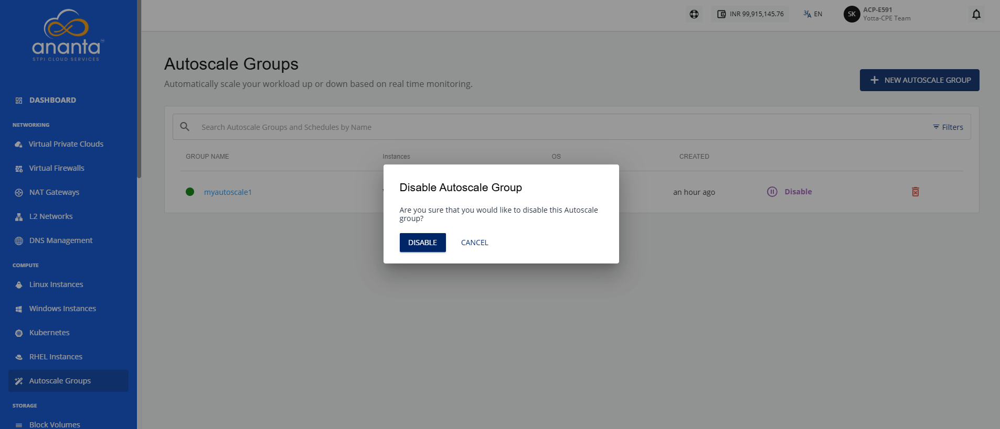
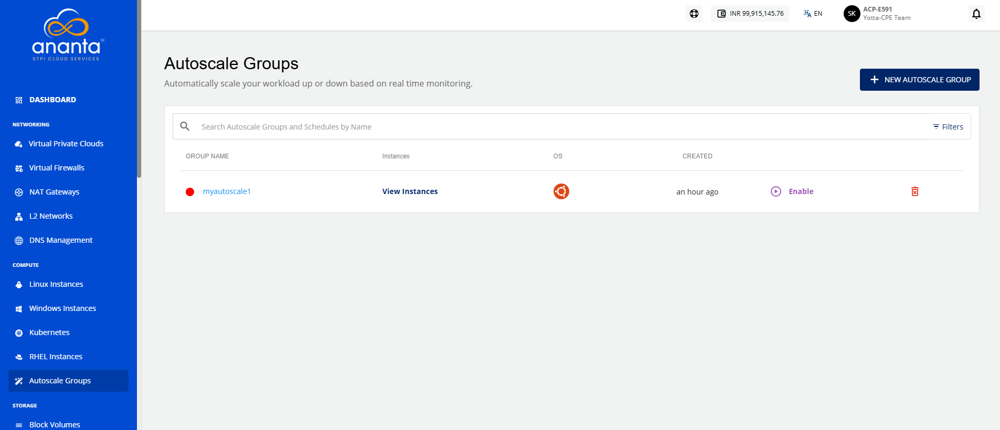
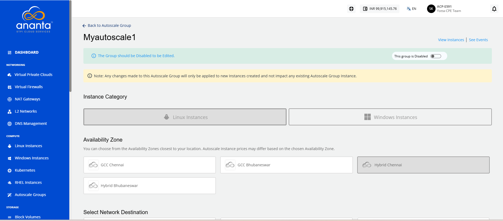
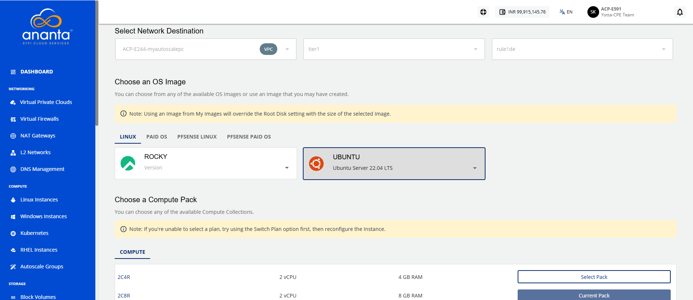
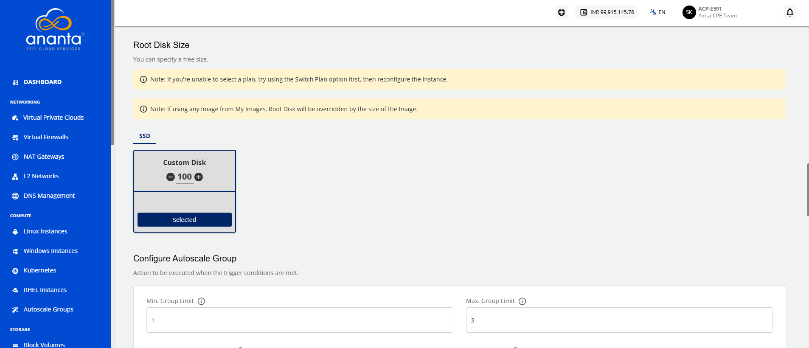
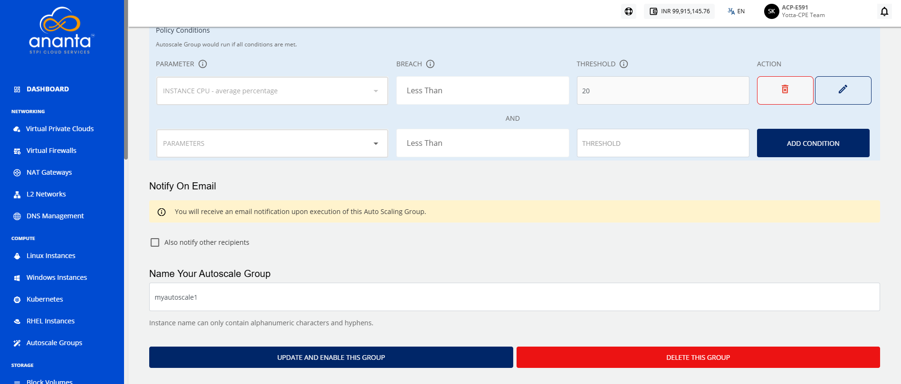
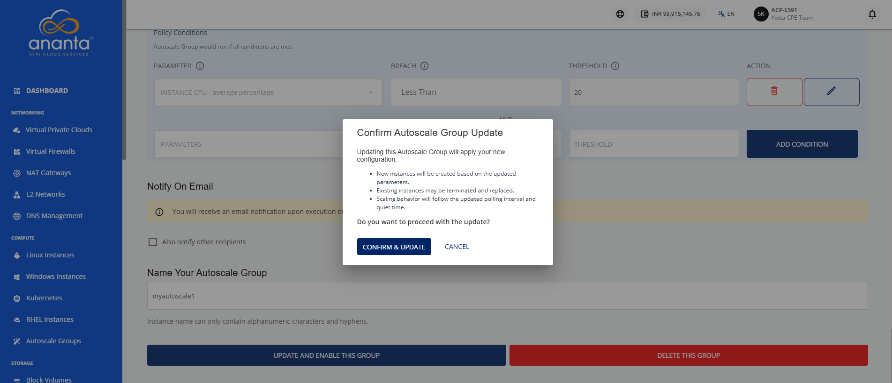

# Modifying Configurations

You can change settings such as compute resources, OS image, and disk configuration on an existing Autoscale group. To do so, disable the group, open its configuration settings, update the parameters you need, and apply the changes.

To modify the Autoscale group configurations, follow these steps:

1. Navigate to **Compute > Autoscale Groups**. The following screen appears:
2. Click the **Disable** icon. The following screen appears:  
3. Click the **Disable** button. The following screen appears: 
4. Click on your Autoscale group name. The following screen appears:
   
   
   
5. You can modify the following configurations:
	- OS image (must belong to the same zone)
	- Compute offering (CPU/RAM)
	- Disk size (≥ template minimum)
	- Configure Autoscale Group
	- Scale Up Policy
	- Scale Down Policy
	- Email Notification
	- Autoscale Group Name
:::note
	When using custom images to create or update an Autoscale group, the root disk settings are applied based on the image configuration. Images with a fixed disk size use the default value, images that support overrides display the minimum size by default, and images without a defined disk size require you to select a disk offering or enter a custom size.
:::
6. Click **Update and Enable This Group** button. The following screen appears:
7. Click the **Confirm and Update** button.