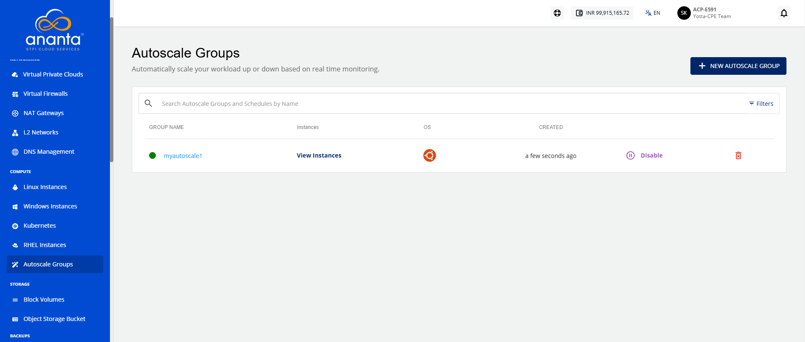

# Viewing Autoscale Groups

This section provides an overview of all configured autoscaling groups in your environment. You can view the available groups, monitor their status, and access details to manage or review their configurations. This view helps you track and manage the resources associated with autoscaling.

To view Autoscale groups, navigate to **Compute > Autoscale Groups**.
