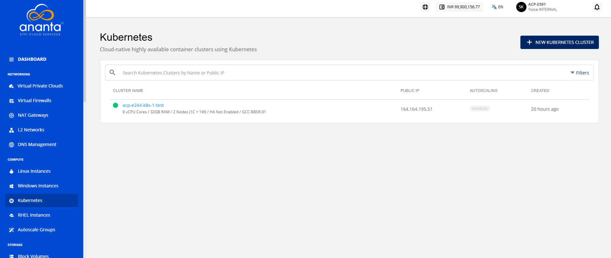
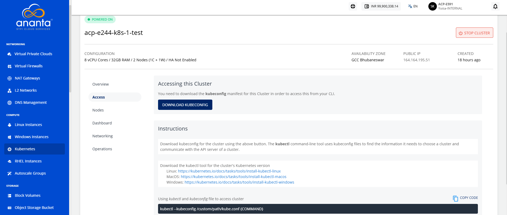

# Accessing a Cluster using the Command Line

To access the Kubernetes clusters, use the `kubeconfig` on the command line. Each cluster has a unique manifest which is required to identify and target the cluster using the `kubectl` utility.
To do this, follow these steps:
1. Navigate to **Compute > Kubernetes**. The following screen appears:
2. Click on your created Kubernetes cluster.
3. Navigate to **Access**.
4. To access the cluster from CLI, click the **Download Kubeconfig** button.

## Downloading kubectl

You can download the kubectl utility for the correct Kubernetes version for any of these operating systems:

- [Linux](https://storage.googleapis.com/kubernetes-release/release/v1.23.3/bin/linux/amd64/kubectl)
- [MacOS]( https://storage.googleapis.com/kubernetes-release/release/v1.23.3/bin/darwin/amd64/kubectl  )
- [Windows](https://storage.googleapis.com/kubernetes-release/release/v1.23.3/bin/windows/amd64/kubectl.exe)

## Using kubectl

To access the cluster on the CLI, run the following command:

```
kubectl --kubeconfig /custom/path/kube.conf {COMMAND}
```
Click the **Download kubeconfig** button. The `kubectl` command-line tool uses kubeconfig files to find the information it needs to choose a cluster and communicate with the API server of a cluster.

- **List Pods:** Lists all pods across all namespaces in the Kubernetes cluster.
- **List Nodes**: Lists all nodes in the Kubernetes cluster, including their status and roles.
- **List Services**: Lists all services across all namespaces in the Kubernetes cluster.
```
List pods kubectl --kubeconfig /custom/path/kube.conf get pods --all-namespaces  
List nodes kubectl --kubeconfig /custom/path/kube.conf get nodes --all-namespaces  
List services kubectl --kubeconfig /custom/path/kube.conf get services --all-namespaces  
```


