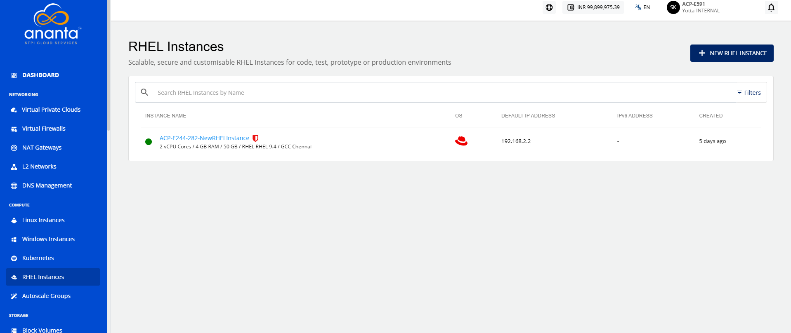
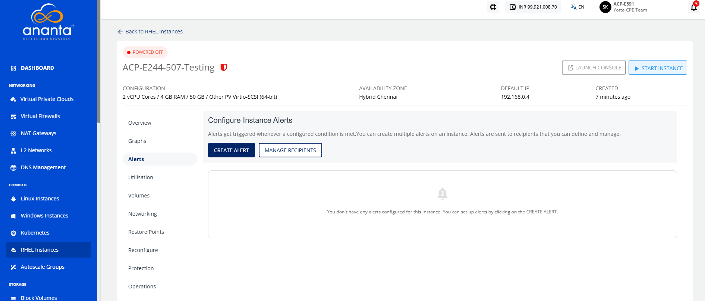
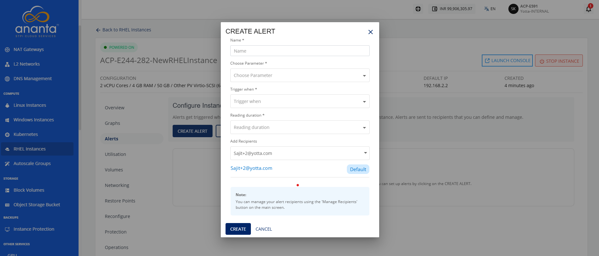
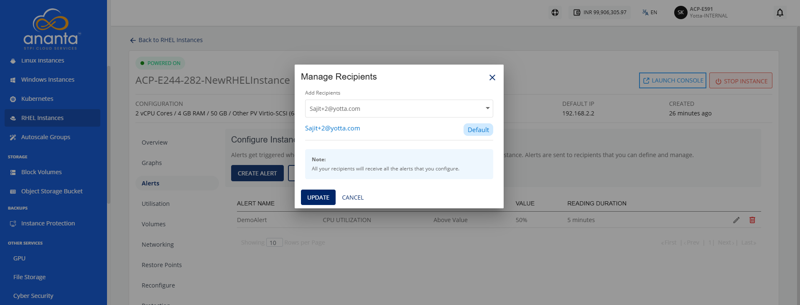

# Managing Alerts

Alerts help you monitor the health and performance of your RHEL instance by notifying you when predefined conditions are met. You can create, view, modify, or delete alerts and manage email recipients to ensure the appropriate users receive notifications. Managing alerts enables you to proactively monitor your RHEL instance and respond promptly to important events.

This section comprises of the following sub-sections:
- [Configuring Alerts](#configuring-alerts)
- [Managing Recipients](#managing-recipients)

## Configuring Alerts

Create an alert to monitor a specific RHEL instance metric and receive an email notification when the configured threshold is reached. While creating an alert, specify a name, select the parameter to monitor, define the trigger condition and reading duration, and add the email recipients for notifications.

To configure alerts, follow these steps:

1. Navigate to **Compute > RHEL Instances**. The following screen appears:
2. Click on your created RHEL instance name from the list, and navigate to **Alerts**.
3. Click the **Create Alert** button. The following screen appears: 
4. Provide the following details:
	- **Name**: You can define the name for your alert.
	- **Choose Parameter**: This option allows you to define what parameter needs to be monitored to trigger the alert email. The NGC supports CPU, RAM, Disk, 1-min Load Average, 5-min Load Average, and 15-min Load Average parameters.
	- **Trigger when**: This set of options lets you define whether to trigger above or below a custom value.
	- **Value in percentage**: This option lets you to define the threshold value in percentage for alert creation.
	- **Reading duration**: This option lets you define the breach window, that is, the duration for which the breach must be consistent to trigger the alert email.
	- **Add Recipients**: This option lets you add recipients from the dropdown.

## Managing Recipients

The manage recipients feature lets you control who receives RHEL instance alerts. It displays all configured or added email IDs and provides options to remove outdated addresses or add new ones.

To remove existing email IDs and add other email IDs, follow these steps:

1. Navigate to **Compute > RHEL Instances**. The following screen appears:
2. Click on your created RHEL instance name from the list, and navigate to **Alerts**.
3. Click the **Manage Recipients** button. The following screen appears: 
4. Click the dropdown icon in the **Add Recipients** field to view the recipients list.
5. Select the recipients from the dropdown.
6. Click the **Update** button.
   

:::note
All configured recipients will receive all the set-up alerts. If no email ID is configured or added, then no email will be sent for the already configured alerts.
:::

