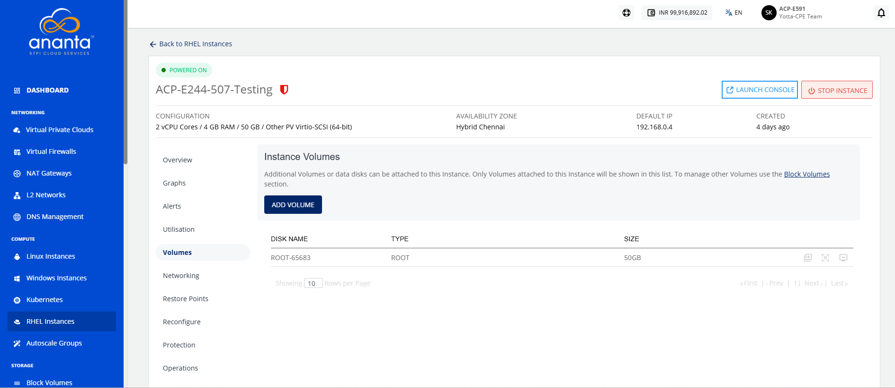

# Managing Volume

Manage volumes to monitor and protect the storage resources attached to your instances. Volume management allows you to view attached disks, create disk restore points to safeguard data before changes, and create custom images for rapid instance deployment and recovery. These operations help ensure data protection, simplify backup and restoration, and maintain consistent storage configurations across your cloud environment.

This section comprises of the following sub-sections:

The following are the quick actions:

- **Create Template** - To enter the image name and description, click the icon
- **Create Snapshot** - To create a Volume snapshot, click the icon.
- **Detach/attach** - This option attach/detach the volume to/from the instance.

:::note
Volume-level operations are available as part of the Block Volumes service.
:::

:::note
Create Template and Restore point actions are not available for encrypted offerings.
:::

