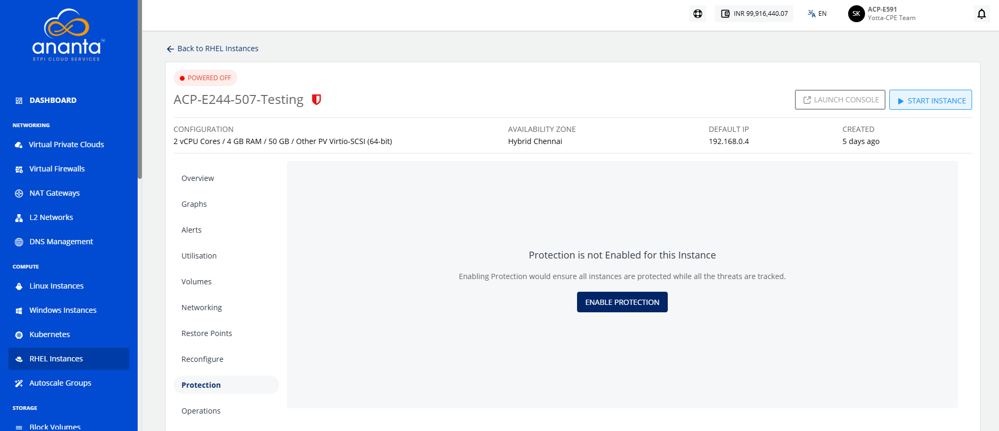
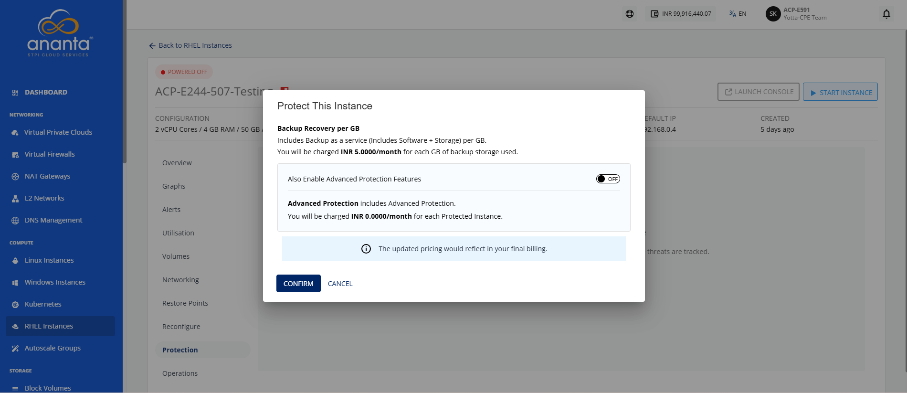
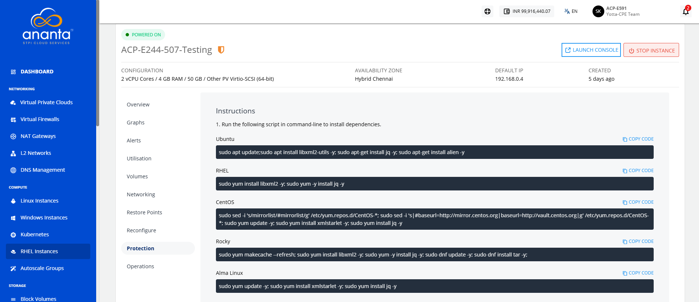

# Protecting RHEL Instances

Enabling protection ensures that all instances are protected while all the threats are tracked.

To enable instance protection, follow these steps:

1. Navigate to **Compute > RHEL Instances**. The following screen appears:
2. Click on your created RHEL instance name from the list.
3. Navigate to **Protection**. The following screen appears:   
4. Click the **Enable Protection** button. The following screen appears:
5. To enable advanced protection features such as antivirus, anti-malware and backup/restore service for the SQL databases, turn on the toggle button. 
6. Click the **Confirm** button. The following screen appears:
7.  Run the respective script (mentioned under Point No. 1) in command-line to install dependencies.
8.  Run the script mentioned on the screen (mentioned under Point No. 2) in command-line to install Protection Agent.

