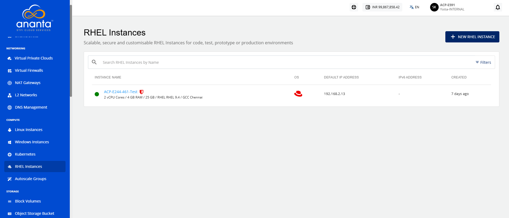
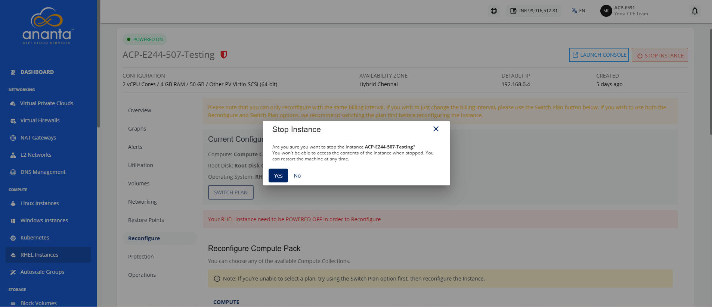
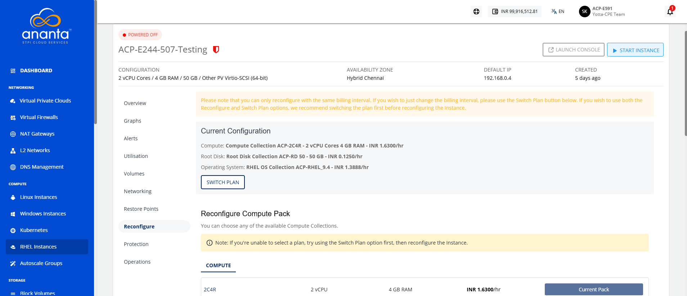
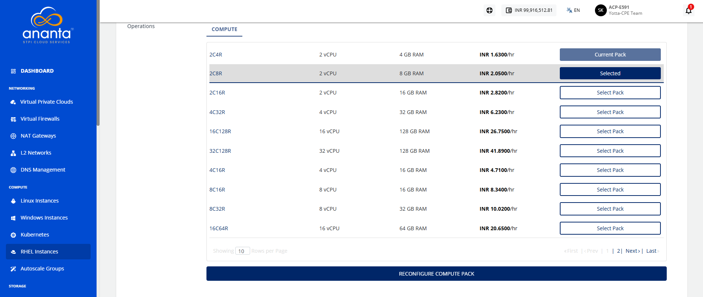
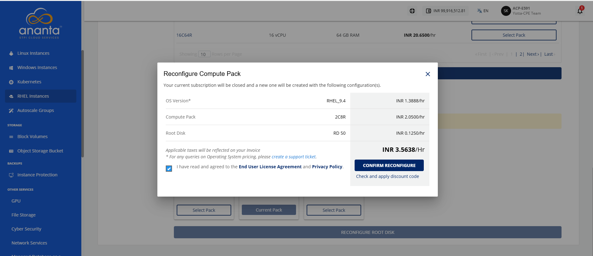
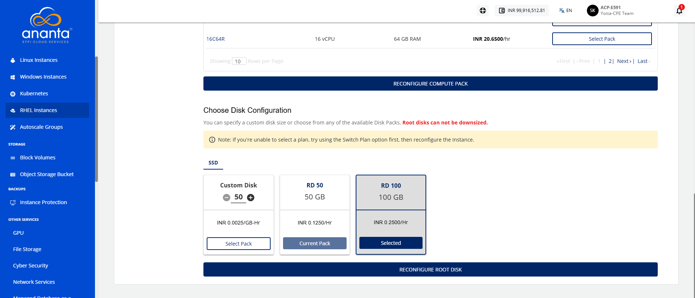
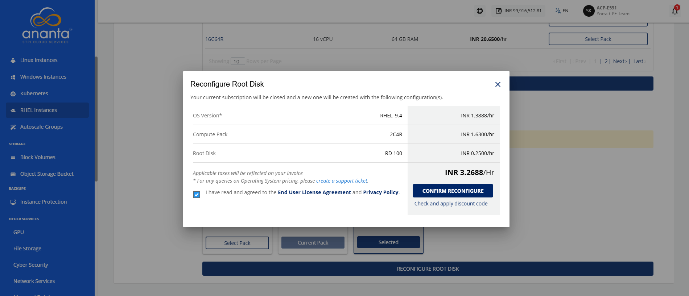

# Reconfiguring RHEL Instances

Reconfigure a window instance to change its compute and root disk configuration when your workload requirements change. Updating the compute pack and root disk allows you to allocate resources that better match your application's performance and capacity needs.

:::note
You can only reconfigure with the same billing interval. If you wish just to change the billing interval, please use the Switch Plan button. We recommend switching the plan first before reconfiguring the Instance if you wish to use both the Reconfigure and Switch Plan options. You will be charged as per the pack you have reconfigured, not based on the older pack.
:::

To reconfigure the window instances, follow these steps:

1. Navigate to **Compute > RHEL Instances**. The following screen appears:
2. Click on your created RHEL instance name from the list, and navigate to **Reconfigure**.
3. Click the **Stop Instance** button. The following screen appears:
4. Click the **Yes** button. The following screen appears:
5. Select a compute pack from the list.  
6. Click the **Reconfigure Compute Pack** button. The following screen appears:
7. Select the **I have read and agreed to the End User License Agreement** and **Privacy Policy** option.
8. Click the **Confirm Reconfigure** button. 
9. Select **Root Disk**.
10. Select **Custom Disk** option to specify the required disk size.
11. Click the **Select Pack** button and click **Reconfigure** button. The following screen appears:
12. Select the **I have read and agreed to the End User License Agreement** and **Privacy Policy** option.
13. Click the **Confirm Reconfigure** button.

