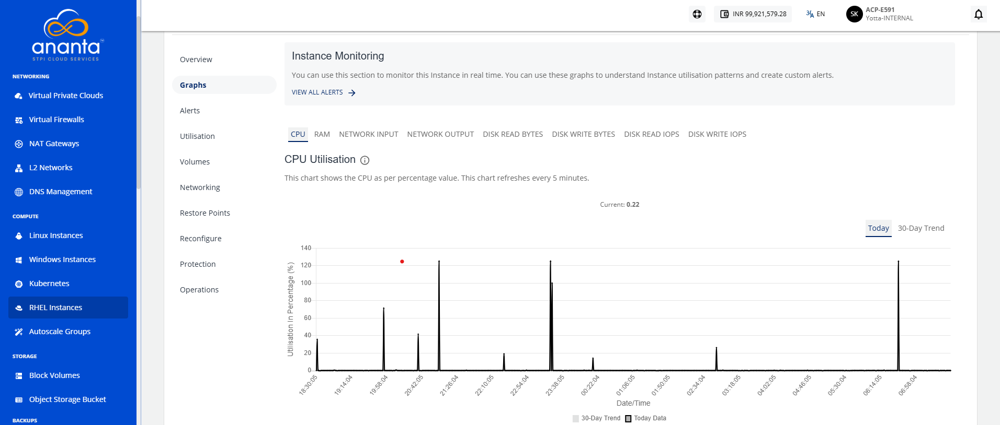

# Viewing Graphs 

Graphs provide a visual representation of the performance and resource utilization of your RHEL instance. You can monitor key metrics such as CPU, memory, network traffic, and disk activity over time to track usage patterns, identify performance trends, and help ensure the instance operates efficiently.

To view graphs, follow these steps:

1. Navigate to **Compute > RHEL Instances**. The following screen appears:
2. Click on your created RHEL instance name from the list.
3. Click **Graphs**. The following screen appears:

