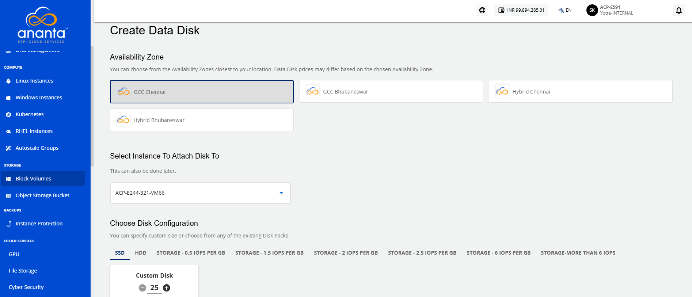
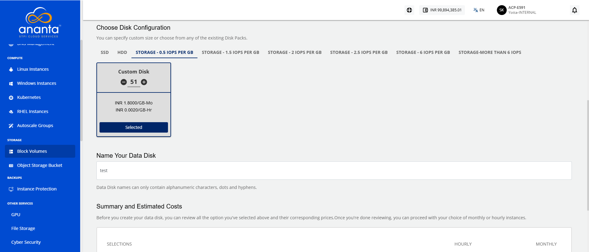
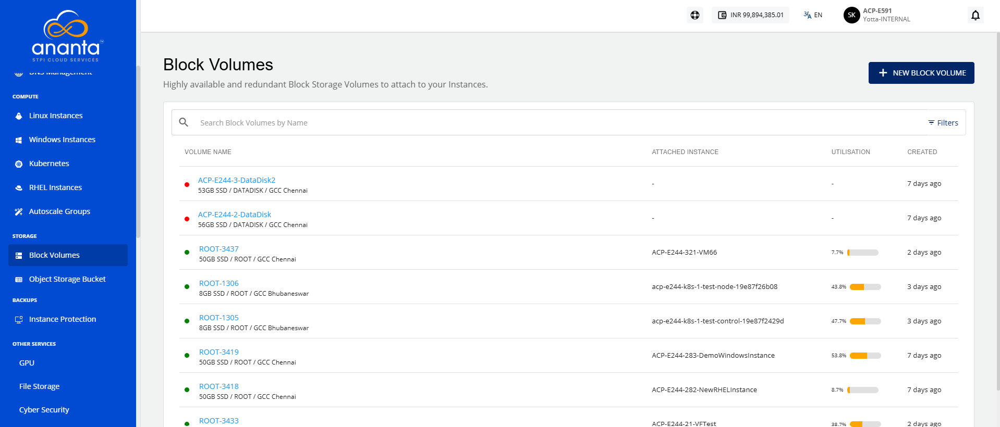
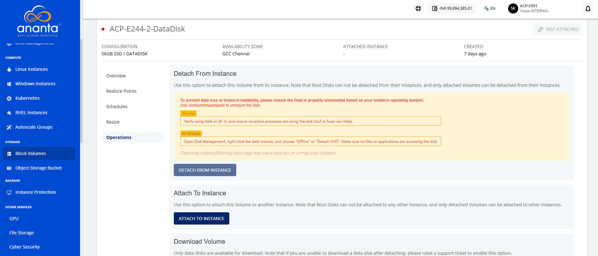
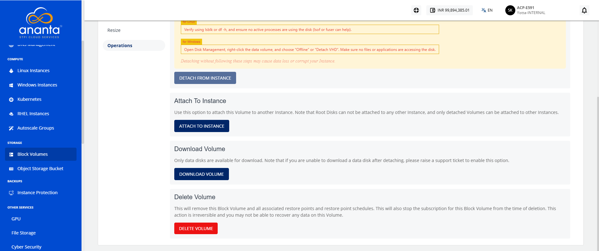

# Creating Data Disk

A data disk is additional storage attached to a cloud instance for storing application data, files, databases, and other workloads separately from the system disk. Creating a data disk in Yntraa Cloud helps improve data management, provides flexibility to scale storage as needed, and ensures better performance and organization of your cloud resources.

To create a data disk, follow these steps:

1. Navigate to **Storage > Block Volumes.** The following screen appears:
	
2. Click the **New Block Volume** button. The following screen appears:   
3. Select Availability Zone.
4. Select an Instance from the dropdown to attach the disk to.
5. In the **Choose Disk Configuration** section:
    - Select the desired disk tier (**Tier1, Tier2, or Tier3**).
    - Click the **Custom Disk** option and adjust the disk size using the plus (+) or minus (–) controls as per requirement.
    - Click the **Select Pack** to choose the configured disk pack.
	
6. Enter the name of data disk in **Name Your Data Disk**.
7. Select the **I have read and agreed to the Cloud Terms and Conditions Privacy Policy** option, and click the **Buy Monthly** button.
8. Click the **Confirm** button.

	:::note
	This might take up to 5-8 minutes. You may use the Cloud Console during this time, but it is advised that you do not refresh the browser window.
	:::

Once ready, you’ll be notified of this purchase on your email address on record. The newly created Data Disk can be accessed from **Storage >** **Block Volumes** on the main navigation panel.

## Attaching/Detaching Volumes

Data disks can be attached to or detached from Instances. This action can be considered similar or equivalent to using an external disk drive on a laptop or computer. The following points should be considered while working with data disks:

1. Data disks can be attached to only one Instance at any given point in time;
2. Data disks can remain detached/unattached;
3. Data disks can be used across Instances with different operating systems;
4. Data disks can only be used on Instances in the same Availability Zone.

Attachment/detachment actions can be performed from the **Operations** section/tab under data disk details.

## Downloading a Volume

Detached data disks can be downloaded as 'virtual hard disk' files for portability. This option is also available in the **Operations** section/tab of data disk details.

:::note
Data disks will be downloaded as .ova files.
:::

## Deleting a Volume

Data disks can be deleted from the **Operations** section/tab in the data disk details. Deleting a data disk will remove the Volume and all associated snapshots and snapshot schedules, and is an irreversible action.

To delete a root disk/volume, simply delete the parent Instance.

