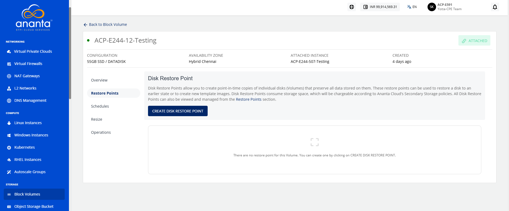
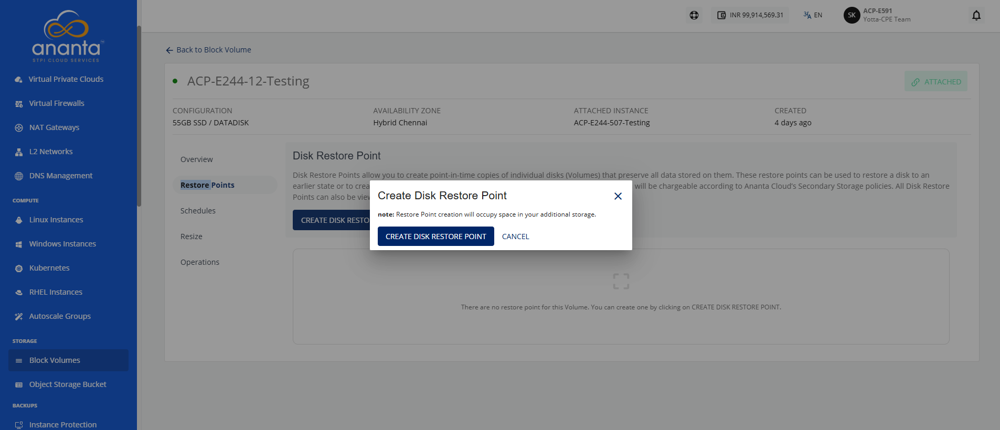
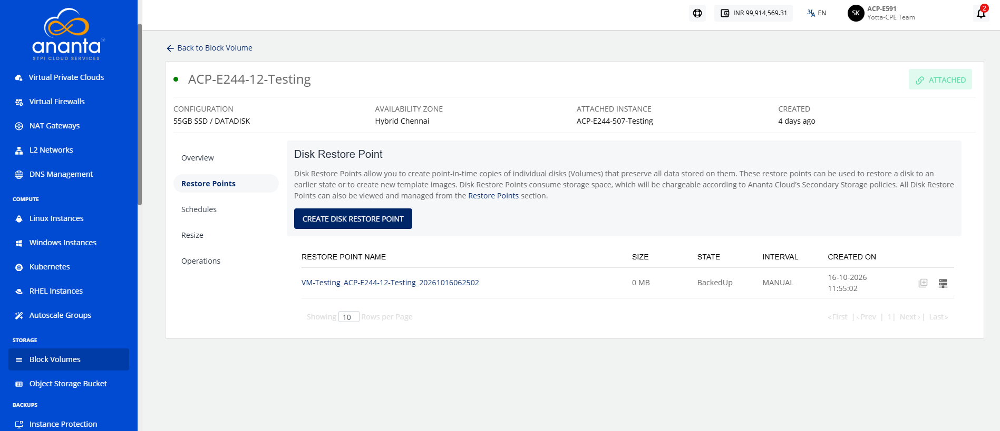
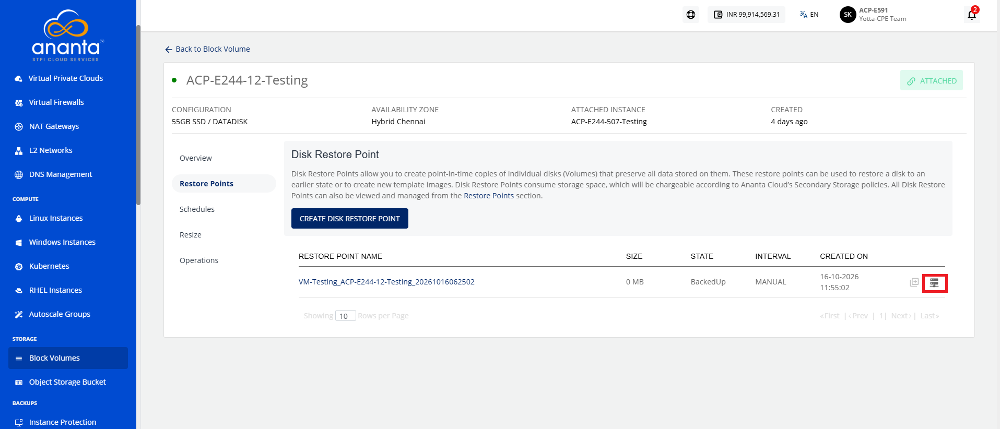

# Creating Disk Restore Points and Volumes

Disk restore points capture the state of a block volume at a specific point in time, allowing you to restore the source volume or create a new volume from the captured data. This enables reliable backup, recovery, and rapid provisioning of additional volumes while helping protect data and maintain business continuity.

## Creating a Disk Restore Point

Creating a disk restore point helps protect your system by saving the current state of a disk before you make significant changes. You can use a restore point to recover the disk to its previous condition if an update, configuration change, or software installation causes unexpected issues. By creating restore points regularly, you reduce the risk of data loss, minimize downtime, and ensure a reliable recovery process when needed.

To create a disk restore point, follow these steps:

1. Navigate to **Storage > Block Volumes.** The following screen appears:
	
2. Click on your created Block Volume.
3. Navigate to **Restore Points**. The following screen appears:
4. Click the **Create Disk Restore Point**. The following screen appears:
5. Click the **Create Disk Restore Point**. The following screen appears:

## Creating Volume from Disk Restore Point

A data disk is additional storage attached to a cloud instance for storing application data, files, databases, and other workloads separately from the system disk. Creating a data disk in Ananta Cloud helps improve data management, provides flexibility to scale storage as needed, and ensures better performance and organization of your cloud resources.

To create volume from disk restore point, follow these steps:

1. Navigate to **Storage > Block Volumes.** The following screen appears:
	
2. Click **Restore Points**. The following screen appears:
3. Click the **Create Disk Restore Point**. The following screen appears:
4. Click the **Create Disk Restore Point**. The following screen appears: 
5. Click the [**Create Volume**](/docs/Guide/Storage/BlockVolumes/CreatingDataDisk) icon (highlighted in red) to initiate the create volume or data disk procedure.
