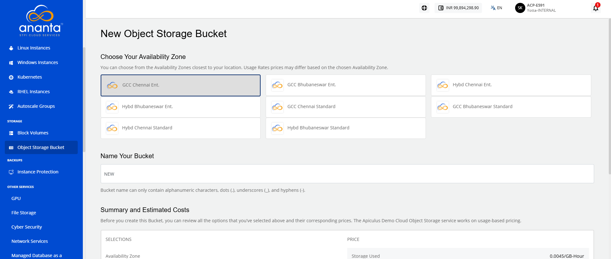
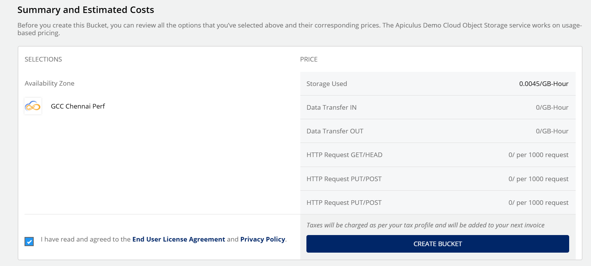
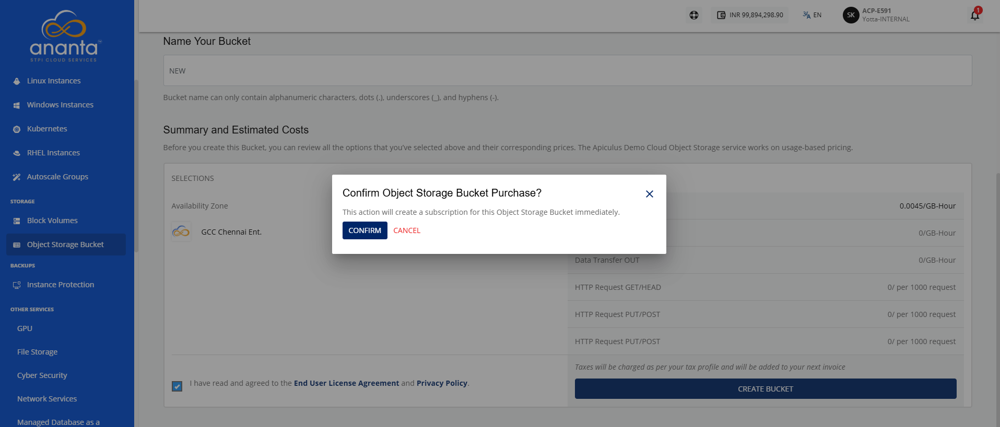

# Creating Object Storage Bucket

Creating object storage enables you to set up a scalable and reliable storage environment for storing and managing various types of data. It allows you to efficiently organize, access, and manage data while providing flexibility, security, and optimized storage capabilities.

To create an Object Storage Bucket, follow these steps:

1. Navigate to **Storage > Object Storage Bucket**. The following screen appears: 
2. Click the **Create Bucket** button. The following screen appears: 
3. Choose Your Availability Zone from the listed options.
	:::note 
	Pricing may vary based on the selected availability zone.
	:::
4. In the **Name Your Bucket** field, enter a valid bucket name.
5. Review the **Summary and Estimated Costs**.
	
6. Select the **I have read and agreed to End User License Agreement** and **Privacy Policy** option.
7. Click the **Create Bucket** button. The following screen appears:
	
8. Click the **Confirm** button.

