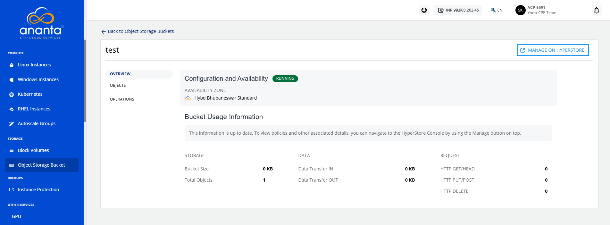

# Deleting Object Bucket

The delete object bucket feature allows you to permanently remove an object storage bucket that is no longer required. Deleting unused buckets helps maintain an organized storage environment and reduces unnecessary resource management.

:::warning
	This action cannot be undone and only empty buckets can be deleted. Before deleting the object storage bucket, ensure that all objects have been removed from the bucket.
:::

To delete an object storage bucket, follow these steps:

1. Navigate to **Storage > Object Storage Buckets**. The following screen appears:
 2. Click on your created object storage bucket name from the list. The following screen appears with the details: 
 3. Click **Operations**. The following screen appears:
 4. Click the **Delete Bucket** button. The following screen appears:
 5. Select the **I confirm I have removed all Objects from this Bucket** option.
6. Enter **DELETE** and click the **Delete** button.
