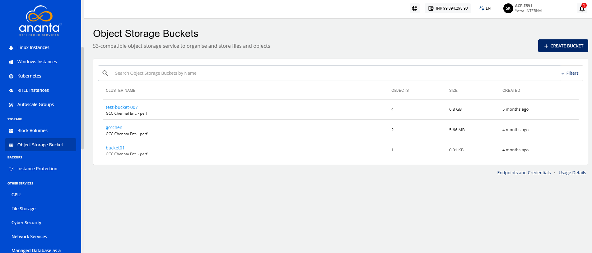

# Viewing Object Storage Bucket Details

Viewing object storage bucket details allows you to review the bucket configuration, availability status, storage usage, and activity metrics. It helps you monitor bucket performance, track data utilization, and access important information required for effective storage management.

To view an object storage bucket details, follow these steps:

1. Navigate to **Storage > Object Storage Buckets**. The following screen appears:
 2. Click on your created object storage bucket name from the list. The following screen appears with the details:
 3. **Configuration and Availability:** This displays the following object storage bucket configuration details to help verify its current configuration and operational state:
    - Bucket's status **Running**
    - Availability Zone
    - Bucket Name
- **Bucket Usage and Request Information:** This displays the following storage utilization, data transfer activity, and request metrics associated with the object storage bucket. It helps monitor bucket usage, track data movement, and analyze interactions performed on the stored objects:

    - Bucket Size
    - Total Objects
    - Data Transfer In
    - Data Transfer Out
    - HTTP GET/HEAD Requests
    - HTTP PUT/POST Requests
    - HTTP DELETE Requests